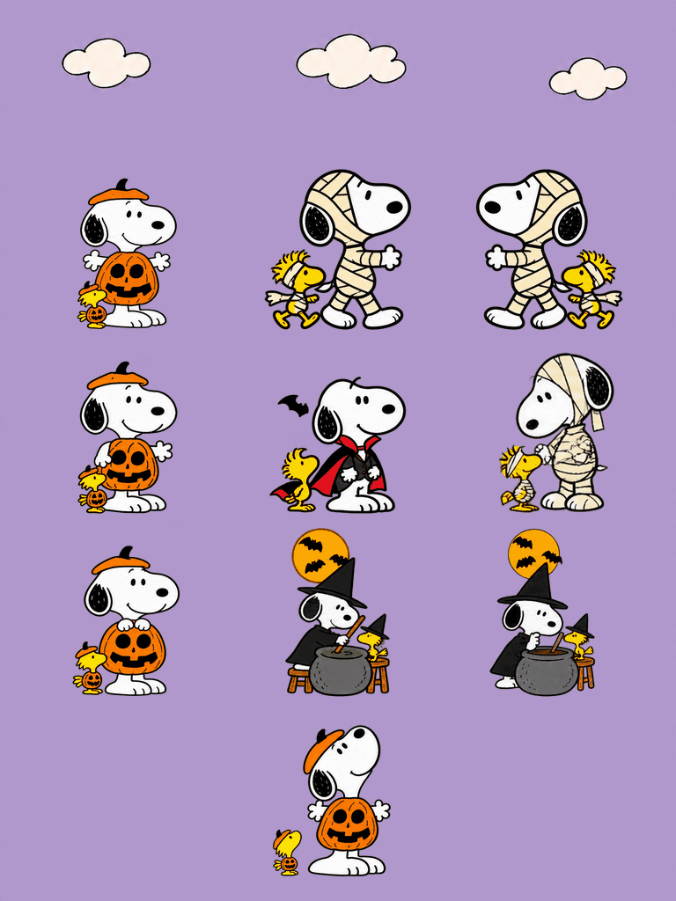

# Halloween Snoopy & Woodstock

[中文](README.zh-CN.md) · English

Snoopy and Woodstock dress up for a little Halloween adventure.



An unofficial *Peanuts* fan-made desktop pet: pumpkin Snoopy at rest, mummy walks, a vampire hop, and witchy potion making. Woodstock has his own little movements, with animated bats joining the Halloween scenes. Artwork was made with AI assistance. The approved R4 PNG is preserved unchanged.

## Download and use

[Codex Pets](https://codex-pets.net/#/pets/snoopy-halloween) · [Release downloads](https://github.com/Ian-Wuu/snoopy-halloween-pet/releases/latest)

- [Transparent PNG sprite sheet](assets/spritesheet.png)
- [Simultaneous GIF](previews/grid-all.gif) · [MP4](previews/grid-all.mp4)
- [Individual animations](animations)
- [Bilingual manifest](assets/pet.json) · [Chinese](assets/pet.zh-CN.json) · [English](assets/pet.en.json)

With the Pets integration enabled, attach the PNG and ask your app to import it as **Halloween Snoopy & Woodstock**. This repository contains assets and export tools, not a standalone app. Copying files does not import an account pet. The separate manifests let you choose a description manually; they do not enable automatic language switching.

## Motions and playback

Nine states: idle, walk right, walk left, wave, jump, bandage mishap, waiting, stirring a potion, and checking the potion. Sixteen look directions form the tenth preview group. The PNG uses the v2 1536 × 2288 layout, with 192 × 208 cells and 73 populated frames.

The 3:4 portrait preview (768 × 1024) shows all ten groups together without labels, in three columns with the look group centered at the bottom. A pastel lavender sky and redesigned cream clouds sit above the character area, clear of all animation frames. GIF, MP4, and Live Photo use the same approved preview timings. Each action repeats on its own cadence within the 12.8-second presentation; all actions restart when that presentation loops. There is no additional slowdown or cycle stretching. The host app controls actual playback speed and triggers; look poses alone do not add physical mouse tracking.

The approved PNG SHA-256 is `3255e53345018e5952c0b3b4a23df0a3bb3f6ea7b0c83fc792280ef64f9b05d2`. The separate Codex Pets website package uses lossless WebP and copies the idle pose into the website's extra neutral slot. All existing animation cells remain identical.

## Live Photo

Keep `Snoopy-Halloween-Live.JPG` and `Snoopy-Halloween-Live.MOV` together and import both into Apple Photos. The pair passed macOS Photos framework recognition; the release includes its validation report. iPhone import and playback have not been tested. Use the MP4 for ordinary video sharing.

## Rebuild exports

```sh
python3 -m pip install -r requirements.txt
python3 scripts/export-grid.py
```

For a Live Photo, put `video.mp4` and its 0.5-second `cover.png` in a folder, then run on macOS:

```sh
swift scripts/make-live-photo.swift /path/to/folder
```

The script writes a paired JPG/MOV and a Photos recognition report. It does not import into your photo library.

Code: [MIT](LICENSE). Snoopy, Woodstock and *Peanuts* were created by Charles M. Schulz. Character artwork and associated rights are excluded from the code license. This is an unofficial fan project with no official affiliation.
