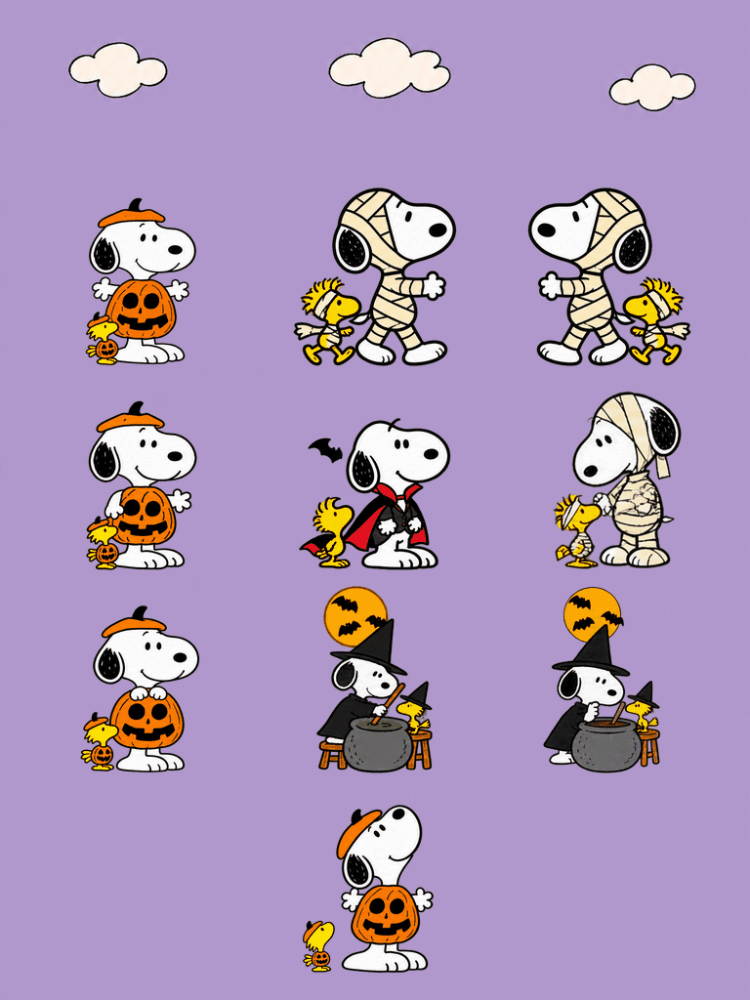

# 万圣节 Snoopy & Woodstock

中文 · [English](README.md)

南瓜装史努比和 Woodstock，把万圣节过成一场小小的换装派对。

以《花生漫画》（Peanuts）里的 Snoopy 和 Woodstock 为原型制作的非官方同人桌宠。南瓜装待机、木乃伊散步、吸血鬼小跳跃、女巫搅药锅，Woodstock 也有自己的小动作，蝙蝠在万圣节场景中改变位置和角度。图像由 AI 辅助制作。仓库保留已验收 R4 透明 PNG 原件。

## 下载与使用

[Codex Pets 下载页](https://codex-pets.net/#/pets/snoopy-halloween) · [GitHub 发布附件](https://github.com/Ian-Wuu/snoopy-halloween-pet/releases/latest)

- [透明图集](assets/spritesheet.png)
- [同时播放 GIF](previews/grid-all.gif) · [普通视频](previews/grid-all.mp4)
- [单独动作](animations)
- [双语简介](assets/pet.json) · [中文简介](assets/pet.zh-CN.json) · [英文简介](assets/pet.en.json)

如果应用已启用 Pets 功能，附上 PNG，请它导入为 **Halloween Snoopy & Woodstock**。这是素材与导出工具仓库，不是独立桌宠软件；复制文件不会导入账号宠物。中英文配置供手动选择，不会自动跟随界面语言切换。

## 动作与速度

包含待机、向右走、向左走、招手、跳跃、绷带小失误、等待回应、搅药锅、检查药锅九类状态，以及十六方向环视。v2 图集为 1536 × 2288 像素，每格 192 × 208，共 73 个有效帧。

展示为两排五格、十组同时播放，不加图内文字。GIF、视频和 Live Photo 沿用同一套已验收逐帧时长，不额外减速、不拉伸动作周期。12.8 秒展示段内各动作按自身周期循环；整段循环时会从头开始。实际桌宠的速度和触发规则由应用控制，环视素材本身不会新增实体鼠标跟随能力。

PNG 原件 SHA-256：`3255e53345018e5952c0b3b4a23df0a3bb3f6ea7b0c83fc792280ef64f9b05d2`。网站专用包使用无损 WebP，并按网站要求在额外中立格复制待机姿态，原有动作格像素相同。

## Live Photo

将 `Snoopy-Halloween-Live.JPG` 和 `Snoopy-Halloween-Live.MOV` 一起保留、一起导入苹果「照片」。已通过 Mac 照片框架识别，发布附件提供配对文件与检查报告；iPhone 导入和播放尚未实测。也提供普通 MP4 视频。

重新导出方式见[英文说明](README.md#rebuild-exports)。

代码采用 [MIT 许可](LICENSE)，不包含角色图像及相关权利。Snoopy、Woodstock 和 Peanuts 由 Charles M. Schulz 创作；本项目为非官方同人，无官方关联。
